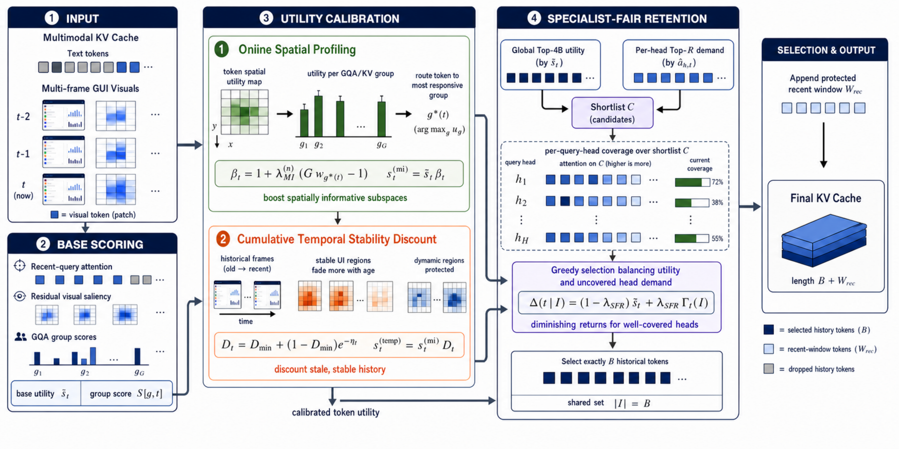

# STaR-KV

KV-cache compression for GUI vision-language models, with online group mutual
information (MI), exponential temporal discount (TEM), and exact specialist-fair
selection (SFR). Supports UI-TARS-1.5-7B and OpenCUA-7B through FlashAttention 2
and bfloat16.



## Layout

```text
starkv/
  starkv_mi.py             # Online spatial MI prior
  starkv_temporal.py       # Exponential temporal stability discount
  starkv_sfr.py            # Exact-greedy specialist-fair selection
  starkv_group_cluster.py  # Base scoring -> MI -> TEM -> SFR -> KV gather
  starkv_utils.py          # Compressor initialization and true vision grids
eval/                     # Evaluators, model attention patches and timing
examples/                 # ScreenSpot-Pro example and local paths
images/main_fig.png       # Current MI/TEM/SFR method overview
requirements.txt
LICENSE.txt
```

The three algorithm components are MI, TEM and SFR. Shared grid validation and
cache construction live in `starkv_utils.py`; model patching and optional timing
remain in `eval/`. SFR uses exact greedy recomputation.

Model weights, datasets and generated results are excluded. This repository
contains the current MI → TEM → SFR implementation.

## Setup

```bash
conda create -n starkv python=3.10 -y
conda activate starkv
pip install torch==2.8.0 torchvision==0.23.0 --index-url https://download.pytorch.org/whl/cu128
PIP_NO_BUILD_ISOLATION=1 pip install -r requirements.txt
cp examples/starkv_local_paths.env.example examples/starkv_local_paths.env
```

Edit the copied file with your Python executable, model and dataset paths.
The local configuration file is gitignored.

## ScreenSpot-Pro

Run UI-TARS-1.5-7B on all ScreenSpot-Pro samples:

```bash
GPU=0 BUDGET=40 bash examples/repro_ssp_kv.sh
# Multiple budgets, evaluated sequentially on the selected GPU:
GPU=0 BUDGETS="10 20" bash examples/repro_ssp_kv.sh
```

Budgets are total retained prefill KV percentages (5, 10, 20 or 40), including
an 8-token recent window (`total_including_window`). For full length `L`, the
total capacity is `C = min(L, max(1, floor(L * budget / 100)))`, the effective
window is `W = min(8, C)`, and SFR selects `B = C - W` historical tokens.
For example, 20% of 2500 tokens retains 492 historical + 8 recent = 500 tokens.
If `C <= 8`, only the most recent `C` tokens are kept; 100% keeps the full cache.
The ratio applies immediately after prefill compression; subsequent decode
tokens append normally. Use a fresh results directory for this budget protocol.
The configured window is restored for each prompt, even after a tiny budget.
The example fixes native GQA `group_mean`,
online group MI (`lambda=0.5`), exponential TEM (`delta=0.2`, `rho=0.9`,
`discount_min=0.1`), and exact SFR (`lambda=0.3`) with TEM-aware coverage.
Single-image ScreenSpot-Pro does not exercise cross-frame temporal discount.

Each run writes its command, log, detailed predictions and summary under
`outputs/repro_ssp_<timestamp>/starkv_b<budget>/`. Set `RESULTS_BASE` to choose
another output directory. Read accuracy from `screenspotpro_summary_results.json`.

## Other benchmarks

The same runtime is used by:

- `eval/screenspotv2_eval.py`
- `eval/androidcontrol_eval.py`
- `eval/agentnetbench_eval.py`

Run a driver with `--help` to inspect dataset and model arguments. Use
`--kv_cache starkv` for compression or `--kv_cache original` for Full Cache.
For multi-frame evaluation, AndroidControl uses history frames and 5 image slots;
AgentNetBench uses 5 image slots and OpenCUA's `current_images` protocol.

## License

See [LICENSE.txt](LICENSE.txt).
